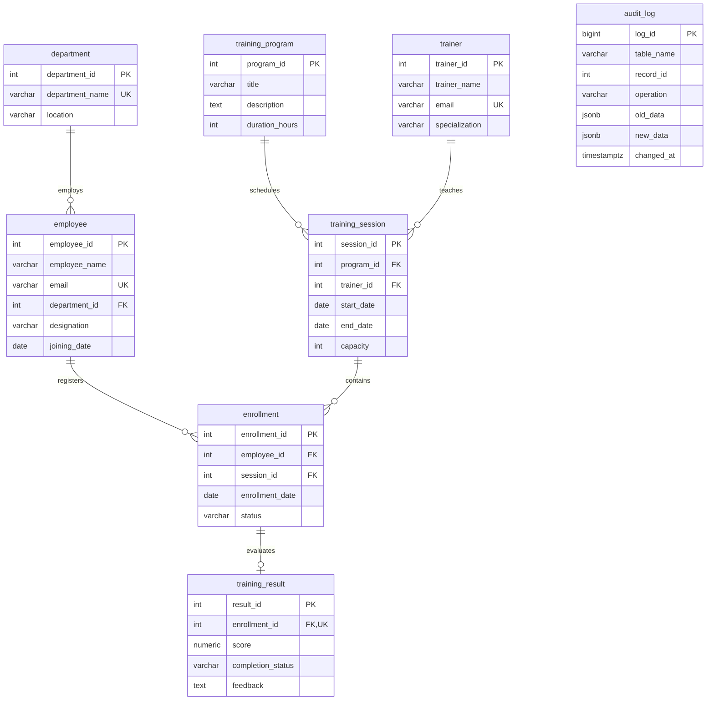

# Entity relationship model

All child FKs are NOT NULL: each employee must participate in exactly one
department; each session must have exactly one program and trainer; each enrollment
must have exactly one employee and session; each result must reference one enrollment.
Parent participation is optional (zero or many children). An enrollment may have
zero or one result, and that result requires Completed status. Employee–session
is M:N resolved by enrollment, with UNIQUE(employee_id,session_id).
All FKs use ON DELETE RESTRICT and ON UPDATE RESTRICT. IDs are identity columns.
Audit records have no FK: historical snapshots survive source record deletion.
The polymorphic table_name/record_id reference describes provenance only.
Nullable attributes: location, designation, specialization, description, feedback,
old_data, new_data, changed_at (defaulted). All other scalar attributes are required.
