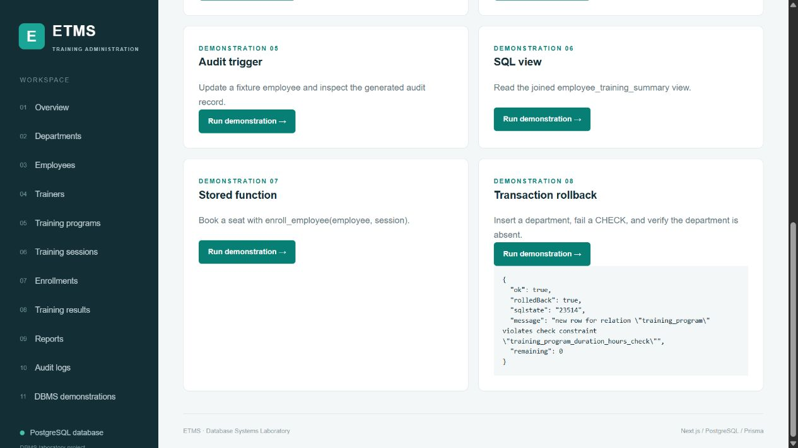

# Verification record

## Current application update

The runtime demonstration page, sidebar link, API and enable flag have been
removed. The UI uses training administration wording throughout. Database test
fixtures now live in tests/fixtures.ts and are not part of the application.

Validation of this update: strict TypeScript check passed; production webpack
build passed in a separate workspace copy to preserve the running development
server; all 20 database check groups passed; 25 HTTP check groups passed,
including CRUD and confirmation that the removed URLs cannot execute operations.
The dashboard was also inspected in the browser without the removed sidebar link.

The record below describes the original implementation before this update;
its demonstration-page checks and screenshot are historical evidence only.

Executed during implementation on Windows using bundled Node.js 24.22.1,
Next.js 16.4.3, Prisma 6.19.0, and a real workspace-local PostgreSQL 17.10
server. The portable binary package is a verification tool, not an application
dependency. The application also includes the standard PostgreSQL 17 Docker setup.

## Executed successfully

- Prisma Client generation and TypeScript strict checking.
- Fresh `prisma migrate deploy`, including custom SQL objects.
- Seed creation: 5 departments, 20 employees, 5 trainers, 8 programs,
  12 sessions, 30 enrollments, 15 results.
- A second seed run made no changes.
- `prisma migrate diff` between live PostgreSQL and Prisma datamodel:
  **No difference detected**. This compares modeled tables; custom objects are
  tested separately rather than being represented in Prisma models.
- Production Next.js build with webpack, including all pages and API routes.
- `tests/database.ts`: **20 passing check groups**, with multiple assertions
  per group. Includes actual two-connection blocking/last-seat booking and
  direct-INSERT versus capacity-reduction races; unsupported isolation rejected.
- All 17 report queries parsed and executed against PostgreSQL.
- `tests/api.ts`: **33 passing HTTP check groups** against the production server:
  10 read endpoints, 2 readable constraint rejection checks, 1 persisted CRUD
  workflow, 8 demonstrations, 1 audit write rejection, and 11 page routes.
- Final test source typecheck passed after the API assertions were added.
- Browser inspection: dashboard counts and session table rendered; employee
  search reduced 20 rows to Aarav's record; employee add form exposed all required
  fields; rollback demo displayed SQLSTATE 23514 and remaining=0.
- Responsive layout inspected at desktop and a narrower browser viewport.

## Practical limits

Turbopack's CSS subprocess exited unexpectedly on this Windows runtime.
The checked-in dev/build scripts explicitly use Next.js's supported webpack
compiler, which built successfully. No schema or business rules were replaced.

Neon hosting, Docker daemon operation, database crash/recovery and large-scale
load were not exercised. PostgreSQL tests used a real local instance, not an
emulator. The deliberately global training write guard favors straightforward
correctness over high write throughput; READ COMMITTED is required and enforced.

Only the dashboard, employee filter/form and rollback demo received interactive
browser checks; every page received an HTTP check. The app has no authentication
by request and is supplied for local administration and university demonstration.

The temporary verification servers were stopped after testing. Follow README.md
to start your own PostgreSQL database and application. The ZIP excludes local
credentials, node_modules, build output, test database files and tooling.

